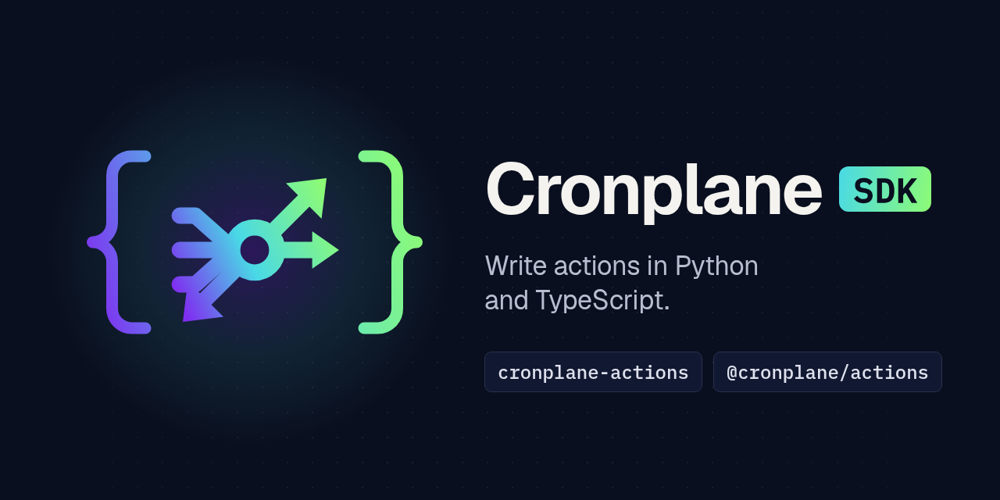

# cronplane-sdk

What you need to write an action for [Cronplane](https://github.com/cronplane/cronplane-ce): the libraries, the contract they obey and the checks an action must pass.

| Folder | Content |
|---|---|
| [`contract/`](contract/README.md) | The contract between a worker and a step, as data: the cases each library must pass. The contract itself is in `SPEC.md` of Cronplane (§18). |
| [`python/`](python/README.md) | `cronplane-actions`: the library to write an action in Python. |
| [`typescript/`](typescript/README.md) | `@cronplane/actions`: the library to write an action in TypeScript, for Bun. |
| [`kit/`](kit/README.md) | The checks of an action (types, lint, tests, audit, licences), the templates of an action and the reusable workflows. |

## Versions

The two libraries have the same version number. That number follows Cronplane: the library `X.Y` works with Cronplane `X.Y` or a later version of the same major version. Before `1.0`, a minor version of Cronplane may break the previous one.

Each library carries the oldest Cronplane it really works with and refuses to start on an older one ([`contract/version`](contract/README.md)). A tag `vX.Y.Z` publishes both: `cronplane-actions` on PyPI and `@cronplane/actions` on npm.

## Licence

Apache-2.0: see [`LICENSE`](LICENSE). The folders `python/` and `typescript/` each hold a copy, because each package must carry the licence it is published under.
